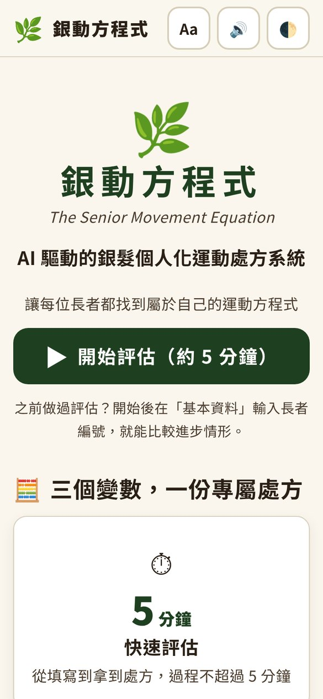
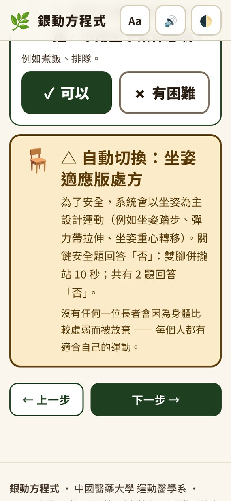
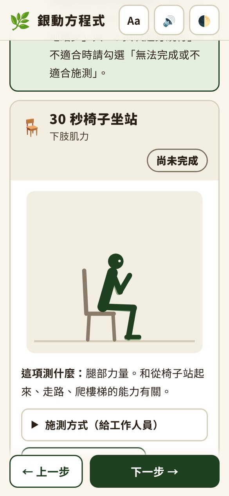
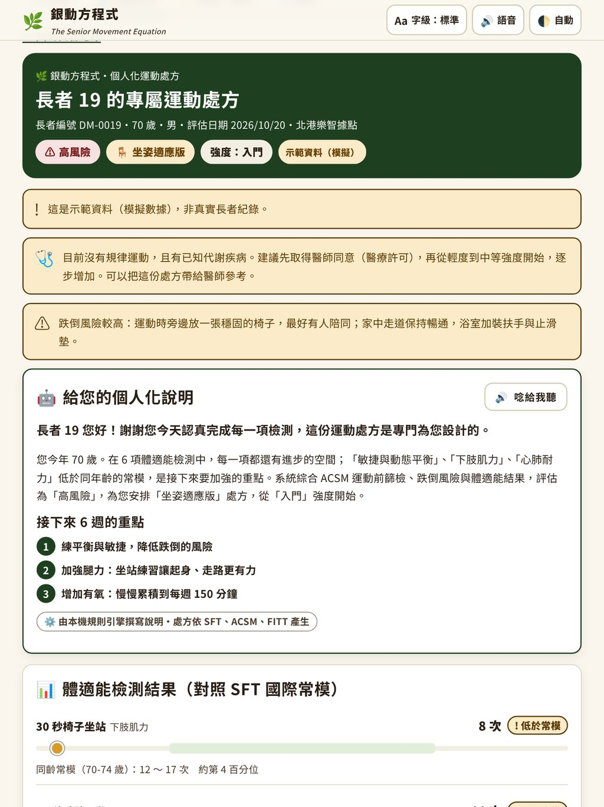
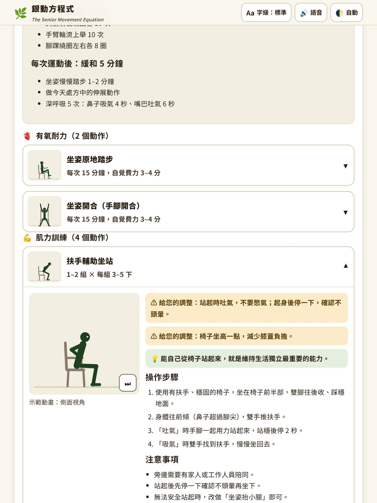
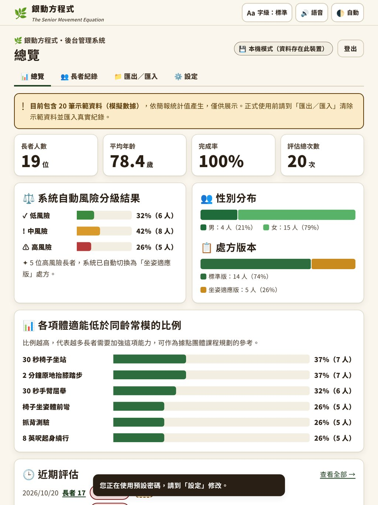

# 🌿 銀動方程式 The Senior Movement Equation

**AI 驅動的銀髮個人化運動處方系統**：以北港樂智據點為實踐場域。
中國醫藥大學 運動醫學系｜2026 北港盃 中醫大創新創意競賽・銀髮樂活教育組

> 長輩們不是不想動，而是不知道該怎麼動。
> 銀動方程式用運動醫學的專業，把原本需要一對一諮詢才拿得到的**個人化運動處方**，帶進社區。

<p>



</p>

---

## 目錄

1. [功能總覽](#功能總覽)
2. [快速開始](#快速開始)
3. [部署到 Netlify](#部署到-netlify)
4. [後台管理](#後台管理)
5. [專業基礎（處方怎麼算出來的）](#專業基礎處方怎麼算出來的)
6. [AI 的角色](#ai-的角色)
7. [資料、隱私與倫理](#資料隱私與倫理)
8. [無障礙設計（WCAG 2.1 AAA）](#無障礙設計wcag-21-aaa)
9. [開發與測試](#開發與測試)
10. [專案結構](#專案結構)
11. [注意事項與限制](#注意事項與限制)

---

## 功能總覽

### 三個變數，一份專屬處方

| 變數 | 內容 |
|---|---|
| ⏱ **5 分鐘快速評估** | 大字、大按鈕、語音朗讀；內建計時器與點按計次，平板就能施測 |
| 🔬 **3 大運動醫學標準** | SFT 銀髮族功能性體適能國際常模 × ACSM 運動前篩檢與風險分級 × FITT 處方原則 |
| 🤖 **AI 個人化生成** | 規則引擎產生處方，Claude AI 用長輩聽得懂的話撰寫個人化說明（無 AI 時自動改用本機引擎） |

### 六步驟流程

| 步驟 | 內容 |
|---|---|
| 1 📜 同意書 | 個資法第 8 條告知、知情同意（必填）、研究使用（選填），隨時可退出並清除資料 |
| 2 📋 基本資料 | 稱呼（可用代號）、性別、年齡；回診長者輸入長者編號即可帶入資料並比較進步 |
| 3 🩺 **動作初篩** | 5 個是非題，**自動分流**為「標準版」或「坐姿適應版」——沒有任何一位長者被放棄 |
| 4 🏃 體適能測驗 | SFT 六項：30 秒坐站、30 秒手臂屈舉、2 分鐘原地踏步、椅子坐姿體前彎、抓背、8 英呎起身繞行；每項都有示範動畫、施測說明、**倒數計時＋點按計次**或**碼錶** |
| 5 ❤️ 健康狀況 | 慢性病、ACSM 徵狀篩檢、規律運動、跌倒史（CDC STEADI）、疼痛部位、血壓心跳、目標與偏好、可用器材 |
| 6 🤖 AI 處方 | 風險分級、SFT 百分位圖、FITT 處方、動作卡（示範動畫＋步驟＋注意事項）、一週計畫、6 週目標、安全守則；可列印帶回家 |

<p>


</p>

### 處方報告內容

- **體適能結果**：六項數值對照同齡同性別常模（第 25～75 百分位），標示「正常／低於常模／需加強」並估算百分位。
- **風險分級與判定依據**：低／中／高風險，列出每一條判定理由（ACSM、跌倒風險、SFT、初篩、血壓）。
- **FITT 處方**：有氧、肌力、柔軟度、平衡的頻率、強度（自覺費力 0–10 分＋說話測試）、時間、類型。
- **43 個動作資料庫**（標準版 30 個、坐姿版 26 個）：每個動作都有**動畫示範人偶**、操作步驟、注意事項（例如「膝蓋不要內扣、不要彎腰駝背」）、呼吸提示，並依疾病自動加上調整（膝關節退化只蹲一半、骨質疏鬆不捲背……）。
- **一週計畫**：每天做什麼、幾分鐘（依長者可運動的天數與時間自動排程；例：每週 5 天 × 30 分鐘 = 150 分鐘）。
- **6 週進展目標**：分「適應期／漸進期／強化期」，並設定第 6 週重新檢測的具體目標值。
- **安全守則**：停止運動的警訊、自覺費力量表、依疾病的注意事項；需要醫療許可或當天不宜運動時顯示醒目提醒。
- **列印／存成 PDF**：A4 約 10 頁，每個動作印出「起始 → 結束」兩個姿勢，長輩帶回家也能照著做。
- **語音朗讀**：每一頁、每個動作都能唸給長輩聽（台灣華語語音）。

### 後台管理系統



- 總覽：長者人數、平均年齡、完成率、風險分級分布、性別與處方版本、各項低於常模比例、近期評估。
- 長者紀錄：搜尋與篩選（風險、版本、性別）、去識別化顯示姓名（王○明）。
- 單筆紀錄：完整處方報告；多次評估自動顯示**前後測進步比較**。
- **一鍵匯出 CSV**（含 BOM，Excel 開啟不亂碼）、研究用去識別化匯出、JSON 備份／還原。
- **CSV 匯入**真實資料（提供範本），系統自動重新計算常模、風險與處方。
- 示範資料載入／清除、資料銷毀、AI 設定、推廣 QR Code、密碼設定。

---

## 快速開始

**只想看看：** 直接用瀏覽器打開 `public/index.html` 也能運作（本機模式）。建議用簡易伺服器：

```bash
npm install
```

```bash
npm run serve
```

開啟 <http://127.0.0.1:8080>。

**完整模擬雲端（含後端 API 與資料庫）：**

```bash
node scripts/serve.mjs --api
```

終端機會顯示後台密碼；若要測試 AI，先設定 `ANTHROPIC_API_KEY` 環境變數再執行。

---

## 部署到 Netlify

### 方法 A：拖曳部署（最快，約 1 分鐘）

1. 登入 [Netlify](https://app.netlify.com/) → **Add new site → Deploy manually**。
2. 把專案中的 **`public` 資料夾**拖進去。
3. 完成！此時為**本機模式**：每台裝置的資料各自存在瀏覽器中（適合據點用一台平板），AI 說明可在後台「設定」輸入金鑰啟用。

### 方法 B：連結 GitHub（建議，正式使用）

1. Netlify → **Add new site → Import an existing project** → 選擇這個 GitHub 儲存庫。
2. 建置設定會自動讀取 `netlify.toml`（發布資料夾 `public`、函式 `netlify/functions`），直接按 Deploy。
3. 到 **Site configuration → Environment variables** 新增：

   | 變數 | 必要 | 說明 |
   |---|---|---|
   | `ADMIN_PASSWORD` | ✅ | 後台密碼（至少 6 個字元）。設定後啟用**雲端資料庫（Netlify Blobs）**，所有平板共用同一個後台 |
   | `ANTHROPIC_API_KEY` | 選填 | Claude API 金鑰；設定後處方說明改由 AI 撰寫 |
   | `ANTHROPIC_MODEL` | 選填 | 預設 `claude-opus-5-5`；可改為 `claude-sonnet-5-5`（較快）或 `claude-haiku-5-5`（最省成本、最快） |

4. 重新部署（Deploys → Trigger deploy）。
5. 想要 `yindong.netlify.app` 這個網址：**Site configuration → Change site name** 改成 `yindong`（若未被使用）。

> 後台「設定」頁的模式標籤會顯示「☁️ 雲端模式」或「💾 本機模式」，可確認是否設定成功。

---

## 後台管理

- 網址：首頁最下方「後台管理」，或 `#/admin`。
- **本機模式預設密碼：`yindong2026`**，第一次登入後請到「設定」立即修改。
- **雲端模式密碼**：Netlify 環境變數 `ADMIN_PASSWORD` 的值。

### ⚠️ 關於示範資料

系統內建 **19 位長者的示範資料**，數值是依簡報中的統計值**模擬**產生的（19 人、平均 78.4 歲、男 4 女 15、低風險 6／中風險 8／高風險 5、長者 19 為 70 歲男性高風險坐姿版），並另含長者 01 的一筆前測紀錄示範進步比較。
**這些不是真實檢測紀錄**，畫面上都標示「示範資料（模擬）」，編號以 `DM-` 開頭。

正式展示或使用前：

1. 後台 → 「匯出／匯入」→ **清除示範資料**。
2. 下載**匯入範本**，把北港據點 19 位長者的真實檢測資料填入（性別、年齡必填；複選欄位用「、」分隔；無法完成的項目填「無法完成」）。
3. **匯入 CSV**，系統會自動重新計算。

---

## 專業基礎（處方怎麼算出來的）

所有判斷都寫在 `public/assets/js/core/`，前端與後端共用同一套程式，並有單元測試。

### 1. SFT 銀髮族功能性體適能常模（`norms.js`）

- 常模：Rikli & Jones（2013）*Senior Fitness Test Manual*（原始常模 1999），60–94 歲、每 5 歲一組、分男女，取**第 25～75 百分位為正常範圍**；坐姿體前彎與抓背由英吋換算為公分。
- 個人百分位：以常態近似（第 25／75 百分位 = z ±0.674）估算。
- 功能退化風險門檻：坐站 < 8 次、手臂屈舉 < 11 次、2 分鐘踏步 < 65 次、起身繞行 > 9 秒；起身繞行 > 8.5 秒為跌倒風險指標（Rose et al., 2002）。
- 我們**不用 BMI** 判斷長者健康：BMI 抓不到肌少症與體脂分布，長者身高縮水也會讓 BMI 失真。

### 2. 動作初篩自動分流（`screening.js`）

5 題：不扶物起身、獨立行走 10 公尺、雙腳併攏站 10 秒、上下一層樓梯、連續站立 10 分鐘。
**關鍵安全題（獨立行走、靜態平衡）任一題「否」，或累計 2 題以上「否」→ 坐姿適應版**；綜合評估為高風險時也會自動切換。

### 3. ACSM 運動前篩檢（第 11 版流程，Riebe et al., 2015）

依「目前是否規律運動」×「是否有已知心血管／代謝／腎臟疾病」×「是否有徵狀」判斷是否需要醫療許可；有徵狀者提醒先就醫或暫停運動。血壓 ≥ 180/110 當天不宜運動、≥ 160/100 只做輕度運動。

### 4. 跌倒風險（CDC STEADI＋客觀檢測）

過去一年跌倒次數、站立不穩、擔心跌倒，加上起身繞行、坐站、靜態平衡結果，計分為低／中／高。

### 5. 綜合風險分級

| 等級 | 條件（任一） |
|---|---|
| 🔴 高風險 | 有疑似心血管徵狀、血壓 ≥ 180/110、動作初篩未通過、跌倒風險高、6 項中 ≥ 4 項低於常模、≥ 2 項落在功能退化風險區 |
| 🟡 中風險 | 有已知心血管／代謝／腎臟疾病（無徵狀）、血壓 160–179/100–109、跌倒風險中等、2–3 項低於常模、1 項風險區、醫師曾限制運動 |
| 🟢 低風險 | 以上皆無 |

### 6. FITT 處方（`prescription.js`）

- ACSM 高齡者建議：有氧中等強度每週累積 150 分鐘（自覺費力 5–6 分）、肌力每週 ≥ 2 天（1–3 組 × 8–15 下）、伸展每週 ≥ 2 天（每個動作累計 30–60 秒）、平衡每週 2–3 天。
- 強度分「入門／基礎／進階」：依平均百分位決定，再依風險、規律運動、需醫療許可等條件下修。
- 動作挑選：依處方版本 → 排除疾病禁忌（例如肩關節問題不做肩推）→ 依器材自動替代（沒有彈力帶改做夾背挺胸）→ 依「低於常模的項目、目標、想加強部位、喜好」計分 → 確保涵蓋腿、手臂、背部。
- 一週計畫依「每週幾天 × 每次幾分鐘」排程，每次含暖身與緩和；6 週目標依弱項設定可達成的進步值。

### 參考文獻

- Rikli, R. E., & Jones, C. J. (2013). *Senior Fitness Test Manual* (2nd ed.). Human Kinetics.
- Rikli, R. E., & Jones, C. J. (1999). Functional fitness normative scores for community-residing older adults, ages 60–94. *Journal of Aging and Physical Activity, 7*(2), 162–181.
- American College of Sports Medicine. (2021). *ACSM's Guidelines for Exercise Testing and Prescription* (11th ed.). Wolters Kluwer.
- Riebe, D., et al. (2015). Updating ACSM's recommendations for exercise preparticipation health screening. *Medicine & Science in Sports & Exercise, 47*(11), 2473–2479.
- Chodzko-Zajko, W. J., et al. (2009). Exercise and physical activity for older adults. *Medicine & Science in Sports & Exercise, 41*(7), 1510–1530.
- Rose, D. J., Jones, C. J., & Lucchese, N. (2002). Predicting the probability of falls in community-residing older adults using the 8-foot up-and-go. *Journal of Aging and Physical Activity, 10*(4), 466–475.
- CDC STEADI – Stopping Elderly Accidents, Deaths & Injuries.
- WHO (2020). *Guidelines on physical activity and sedentary behaviour.*

---

## AI 的角色

- **處方內容（動作、組數、次數、時間、強度）一律由規則引擎依上述標準產生**，AI 不能新增或修改，確保每個建議都有學理根據。
- AI（Claude）負責：用長輩聽得懂的話說明檢測結果、列出 6 週重點、給每個動作的個人化小叮嚀與安全提醒、鼓勵的話。
- 送給 AI 的資料**不含姓名、施測人員與醫師備註**，畫面上再把「{稱呼}」換成長輩的稱呼。
- 使用結構化輸出（JSON Schema），伺服器再檢查與清理內容（移除 HTML、限制字數、只接受處方中真的有的動作）。
- 呼叫方式（依序嘗試）：
  1. **Netlify Function**（建議）：金鑰放在伺服器環境變數 `ANTHROPIC_API_KEY`。
  2. **瀏覽器直接呼叫**：在後台「設定」輸入金鑰，只存在那台裝置（適合拖曳部署的展示環境；勿在公用裝置使用）。
  3. 都沒有、逾時或失敗 → **自動改用本機規則引擎**撰寫說明，處方內容完全相同。
- 已預設啟用 `fallbacks: "default"`（伺服器端備援模型），AI 拒答時會自動改用備援模型；仍失敗則改用本機說明。

---

## 資料、隱私與倫理

| 項目 | 做法 |
|---|---|
| 個資保護 | 系統第一步即為同意書（個資法第 8 條告知）；只收集稱呼（可用代號）、性別、年齡；後台預設去識別化顯示姓名 |
| 知情同意 | 必須勾選同意才能開始；研究使用另外勾選；**隨時可退出**，退出即清除所填資料 |
| 本人刪除 | 長者在結果頁可按「刪除我的資料」（雲端模式以一次性刪除憑證驗證） |
| 資料銷毀 | 後台提供清除示範資料與永久刪除全部資料（需輸入確認文字） |
| 研究匯出 | 「研究用（去識別化）」只匯出同意研究使用者，且移除姓名、施測人員與醫師備註 |
| 雲端安全 | 後台 API 需密碼；伺服器重新驗證與計算所有資料、不信任前端結果；基本流量限制；CSP 等安全標頭 |
| 不商業利用 | 不轉售、不作商業用途；只要是公共樂齡據點，永久免費使用 |

---

## 無障礙設計（WCAG 2.1 AAA）

- 文字對比 ≥ 7:1（實測最低 8.09:1），淺色與深色模式皆符合；狀態一律「圖示＋文字＋顏色」。
- 觸控目標 ≥ 52 px；基本字級 18 px，可切換「大」20 px、「特大」22 px。
- 全部功能可用鍵盤操作，焦點框清楚；選項支援方向鍵；表單皆有標籤。
- 語音導覽（台灣華語）、尊重「減少動態效果」設定、螢幕報讀即時公告。
- 圖表配色通過色盲模擬檢查；每個圖表數值都有文字版本。
- 以 axe-core 檢查所有畫面（淺色／深色）：**0 項違規**。

---

## 開發與測試

```bash
npm install
```

```bash
npm test
```

單元與 API 測試（26 項）：常模、ACSM、風險分級、處方、驗證、示範資料統計、後端 API（使用本機 Netlify Blobs 模擬與模擬的 Claude API）。

```bash
npm run test:e2e
```

端對端測試（23 項，Playwright）：完整六步驟（標準版／坐姿版）、計時器、列印、後台統計／篩選／CSV 匯出匯入、雲端模式、AI（瀏覽器金鑰、伺服器、失敗備援）。截圖輸出到 `tests/e2e/screenshots/`。

其他指令：

| 指令 | 用途 |
|---|---|
| `npm run serve` | 本機伺服器（本機模式） |
| `node scripts/serve.mjs --api` | 本機伺服器＋模擬 Netlify Function 與 Blobs（雲端模式） |
| `npm run build:vendor` | 重新產生 `public/assets/vendor/`（Anthropic SDK 瀏覽器版、QR Code） |
| `npm run build:icons` | 由 `public/favicon.svg` 產生 PWA 圖示 |

---

## 專案結構

```
public/                    ← 網站（Netlify 發布資料夾）
├─ index.html              單頁應用程式
├─ assets/css/app.css      設計系統（AAA 對比、深色模式、列印版面）
├─ assets/js/core/         運動醫學引擎（前後端共用）
│  ├─ norms.js             SFT 常模與評分
│  ├─ screening.js         動作初篩、ACSM、跌倒風險、綜合風險
│  ├─ exercises.js         動作資料庫與示範動畫規格
│  ├─ prescription.js      FITT 處方、一週計畫、6 週目標、安全守則
│  ├─ validate.js          資料驗證
│  ├─ narrative.js         說明文字（AI 提示詞、輸出格式、本機版本）
│  └─ assess.js            評估流程整合
├─ assets/js/data/demo.js  示範資料（模擬）
├─ assets/js/lib/          DOM、示範人偶、語音、儲存、AI、CSV
├─ assets/js/ui/           首頁、評估流程、計時器、報告、圖表、後台
├─ manifest.webmanifest、sw.js、icons/   PWA（可加入主畫面、離線使用）
└─ api/health              未部署函式時的備援狀態檔
netlify/functions/api.mjs  後端 API（Netlify Blobs＋Claude）
netlify.toml               Netlify 設定與安全標頭
scripts/                   開發伺服器、圖示與第三方套件建置
tests/                     單元、API、端對端測試
legacy/                    原本儲存庫中的 Roboflow 範例（未使用）
```

**要修改團隊資訊**（指導教師、競賽名稱等）：`public/assets/js/ui/app.js` 最上方的 `CREDITS`。

---

## 注意事項與限制

- 本系統提供**運動建議，不取代醫師診斷與治療**；運動中如有不適請立即停止並就醫。
- 本機模式的資料存在各裝置瀏覽器，清除瀏覽器資料會一併刪除，請定期到後台匯出備份。
- Netlify Functions 有執行時間上限；若 AI 回應逾時，系統會自動改用本機規則引擎，處方內容不受影響。若常逾時，可將 `ANTHROPIC_MODEL` 改為較快的模型。
- 雲端模式的流量限制為基本防護（以單一執行個體計算）。
- 示範資料為模擬數據，正式使用前請清除並匯入真實資料。
- 更新網站後若畫面未更新，請將 `public/sw.js` 的 `VERSION` 改成新版本號再部署。
