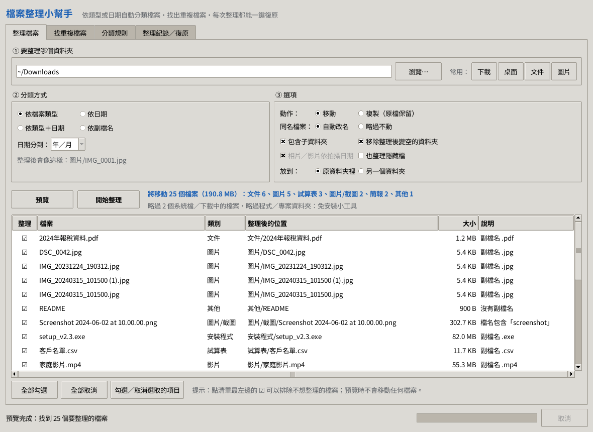
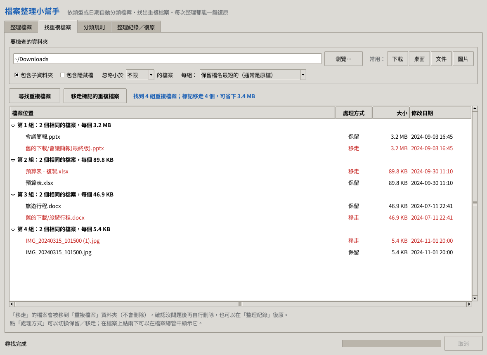
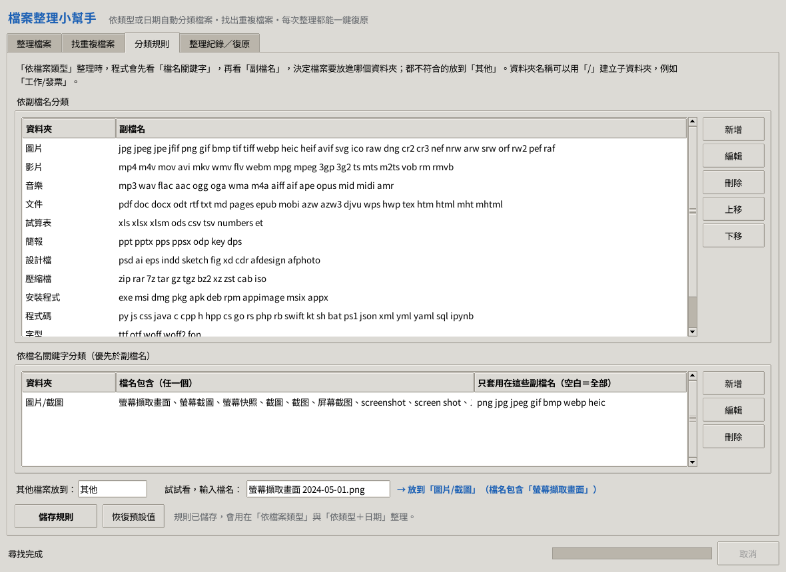

# 檔案整理小幫手

把亂七八糟的「下載」、「桌面」資料夾，依**檔案類型**或**日期**自動分類整理好，也能找出內容重複的檔案。
**每一次整理都會留下紀錄，不滿意可以一鍵復原。**



## 功能

| 功能 | 說明 |
|---|---|
| 四種分類方式 | 依檔案類型（圖片、文件、影片、音樂、壓縮檔…）、依日期（年／月）、依類型＋日期、依副檔名 |
| 相片依拍攝日期 | 讀取相片／影片內的拍攝時間：JPG、HEIC（iPhone）、RAW（DNG、CR2、NEF、ARW…）、MP4、MOV |
| 先預覽再整理 | 預覽每個檔案會被放到哪裡，可以取消勾選不想動的檔案；預覽時不會移動任何東西 |
| 一鍵復原 | 「整理紀錄／復原」分頁可以把任何一次整理的檔案全部移回原位 |
| 找重複檔案 | 比對檔案內容（不看檔名），重複的檔案移到「重複檔案」資料夾，**不會直接刪除** |
| 自訂分類規則 | 新增／修改分類與副檔名，或設定「檔名包含某些字」就放到指定資料夾（例如「發票」→ 文件/發票） |
| 移動或複製 | 可以選擇複製（原檔不動），也可以把結果放到另一個資料夾 |

## 下載與執行

### 方法一：Windows 免安裝版（.exe）

1. 到這個專案的 **Actions** 分頁 → 點最上面（最新）一次「File Organizer」→ 在頁面下方 **Artifacts** 下載 `FileOrganizer-Windows`。
2. 解壓縮後，雙擊 `FileOrganizer.exe` 即可使用。

（下載檔會保留 90 天；過期的話，在 Actions 分頁打開那次執行，按「Re-run all jobs」就會重新產生。）

> 第一次執行時 Windows 可能顯示「Windows 已保護您的電腦」，這是因為程式沒有購買數位簽章。
> 點「其他資訊」→「仍要執行」即可。

Mac（Apple M 系列晶片）可以下載 `FileOrganizer-macOS`，解壓縮（可能要解兩次）後得到 `FileOrganizer.app`。
第一次開啟如果被擋下，請按右鍵 →「打開」，或到「系統設定 → 隱私權與安全性」按「**仍要打開**」。
Intel 晶片的 Mac 請用下面的方法二。

### 方法二：用 Python 執行（Windows／macOS／Linux）

1. 安裝 [Python 3.8 以上版本](https://www.python.org/downloads/)（建議最新版）。
   Windows 安裝時請勾選 **Add python.exe to PATH**。
2. 下載這個專案（綠色 **Code** 按鈕 → **Download ZIP**），解壓縮。
3. 進入 `file-organizer` 資料夾，雙擊：
   - Windows：`run_windows.bat`
   - macOS：`run_mac.command`（第一次請按右鍵 →「打開」）
   - Linux：`run_linux.sh`（需要 `python3-tk`）

不需要安裝任何其他套件，只用到 Python 內建的功能。

## 使用方式

1. **選資料夾**：按「瀏覽…」，或直接按「下載」、「桌面」等常用資料夾按鈕。
2. **選分類方式**：依檔案類型、依日期、依類型＋日期或依副檔名。
3. **按「預覽」**：下方清單會列出每個檔案會被放到哪裡。不想移動的檔案，點最左邊的 ☑ 取消勾選。
4. **按「開始整理」**。
5. 不滿意？到「**整理紀錄／復原**」分頁，選那一次整理，按「**復原這次整理**」。

整理後的樣子（依檔案類型）：

```
下載/
├── 圖片/
│   ├── 截圖/                 ← 檔名含「螢幕擷取畫面」、「Screenshot」的圖片
│   └── IMG_20240315.jpg
├── 文件/      2024年報稅資料.pdf、旅遊行程.docx …
├── 試算表/    預算表.xlsx、客戶名單.csv
├── 影片/      家庭影片.mp4
├── 音樂/      錄音 001.m4a
├── 壓縮檔/    相簿備份.zip
├── 安裝程式/  setup.exe
└── 其他/      沒有副檔名或不認得的檔案
```

依「類型＋日期」時會變成 `圖片/2024/2024-03/IMG_20240315.jpg`。

## 安全設計

- **不會覆蓋任何檔案**：遇到同名檔案會自動改名成「檔名 (1).jpg」（也可以選擇略過）。
- **不會刪除任何檔案**：重複的檔案也只是移到「重複檔案」資料夾，請自己確認後再刪。
- **每次整理都能復原**：每一個動作都會立刻寫進紀錄，就算中途當機或取消，也能復原已完成的部分。
- **自動略過**：隱藏檔、系統檔（desktop.ini、Thumbs.db…）、還在下載中的檔案（.crdownload、.part）、Office 暫存檔、捷徑連結。
- **不拆散程式**：勾選「包含子資料夾」時，看起來像程式或專案的子資料夾（含 .exe、.dll、.git、package.json…）會整個略過，免得程式壞掉。
- **拒絕危險位置**：不能整理整個系統磁碟、C:\Windows、Program Files 等系統資料夾；使用者資料夾本身不能使用「包含子資料夾」。
- **雲端硬碟友善**：OneDrive「僅線上提供」的檔案不會被下載來讀取。

設定與整理紀錄存放在：

- Windows：`%APPDATA%\FileOrganizer\`
- macOS：`~/Library/Application Support/FileOrganizer/`
- Linux：`~/.config/file-organizer/`

## 其他畫面

| 找重複檔案 | 分類規則 |
|---|---|
|  |  |

## 指令模式（進階）

```
python -m file_organizer organize ~/Downloads --dry-run          # 只預覽
python -m file_organizer organize ~/Downloads                    # 預覽後詢問，再整理
python -m file_organizer organize ~/Pictures --by type-date -r   # 依類型＋日期，含子資料夾
python -m file_organizer organize ~/Downloads --copy --dest D:\整理結果
python -m file_organizer stats ~/Downloads                       # 統計各類檔案
python -m file_organizer duplicates ~/Pictures --move            # 找重複檔案並移走
python -m file_organizer history                                 # 整理紀錄
python -m file_organizer undo                                    # 復原最近一次
python -m file_organizer --help                                  # 所有選項
```

## 常見問題

**整理很多照片時有點慢？**
使用「依日期」時，程式需要打開每張相片讀取拍攝日期。可以取消勾選「相片／影片依拍攝日期」改用檔案修改日期，速度會快很多。

**為什麼有些檔案沒有被整理？**
預覽上方會寫出略過的原因，例如隱藏檔、系統檔、正在下載的檔案，或被保護的程式資料夾。

**分類不符合我的習慣？**
到「分類規則」分頁調整，例如新增「電子書」分類放 epub、mobi，或設定檔名含「發票」的檔案放到「文件/發票」。下方可以輸入檔名試試看會被分到哪裡。

## 給開發者

```
file-organizer/
├── file_organizer/
│   ├── gui.py         視窗介面（tkinter）
│   ├── cli.py         指令模式
│   ├── planner.py     產生整理計畫（預覽）
│   ├── executor.py    執行、紀錄與復原
│   ├── scanner.py     掃描資料夾、略過系統與程式檔案
│   ├── rules.py       分類規則
│   ├── metadata.py    讀取拍攝日期（EXIF／HEIC／MP4）
│   ├── duplicates.py  找重複檔案
│   └── safety.py      危險資料夾檢查
├── tests/             自動測試（python -m unittest discover -s tests）
└── launcher.py        PyInstaller 打包入口
```

打包成單一執行檔：

```
pip install pyinstaller
pyinstaller --onefile --windowed --name FileOrganizer --icon assets/icon.ico launcher.py
```
